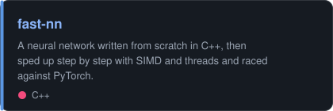
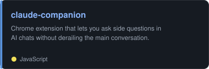
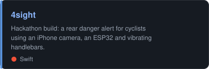
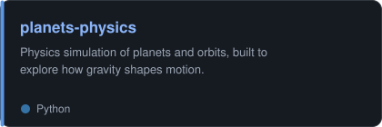

  

<h1 align="center">Arshiya Khayatzadeh</h1>

  <b>Software Developer @ Oneiral</b> &nbsp;·&nbsp; CS Co-op @ University of Toronto

  <a href="https://arshiyakhy.me">Website</a> &nbsp;·&nbsp;
  <a href="https://www.linkedin.com/in/arshiya-khayatzadeh">LinkedIn</a> &nbsp;·&nbsp;
  <a href="https://x.com/ArshiyaKhy">X</a> &nbsp;·&nbsp;
  <a href="mailto:arshiya.khayatzadeh@mail.utoronto.ca">Email</a>

 

## About

- **Now:** building a CPR feedback tool as a software developer at Oneiral
- **Studying:** Computer Science (Software Engineering) at UofT, graduating 2029
- **Into:** backend systems, performance, and AI/ML
- **Off the keyboard:** ten years of piano

## Featured projects

<table>
  <tr>
    <td></td>
    <td></td>
  </tr>
  <tr>
    <td></td>
    <td></td>
  </tr>
</table>

## Tech stack

**Languages** &nbsp; 

**Backend** &nbsp;&nbsp;&nbsp; 

**Frontend** &nbsp;&nbsp; 

**Tools** &nbsp;&nbsp;&nbsp;&nbsp;&nbsp;&nbsp; 

## On repeat

